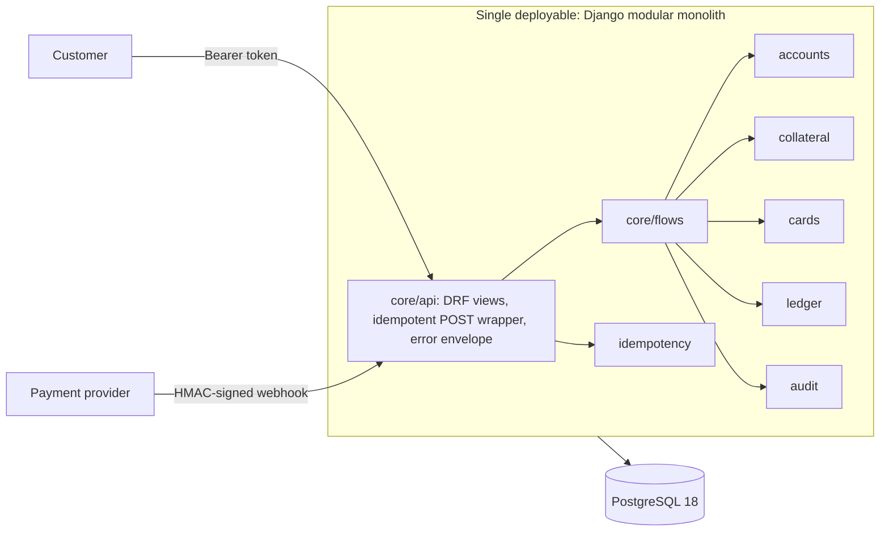
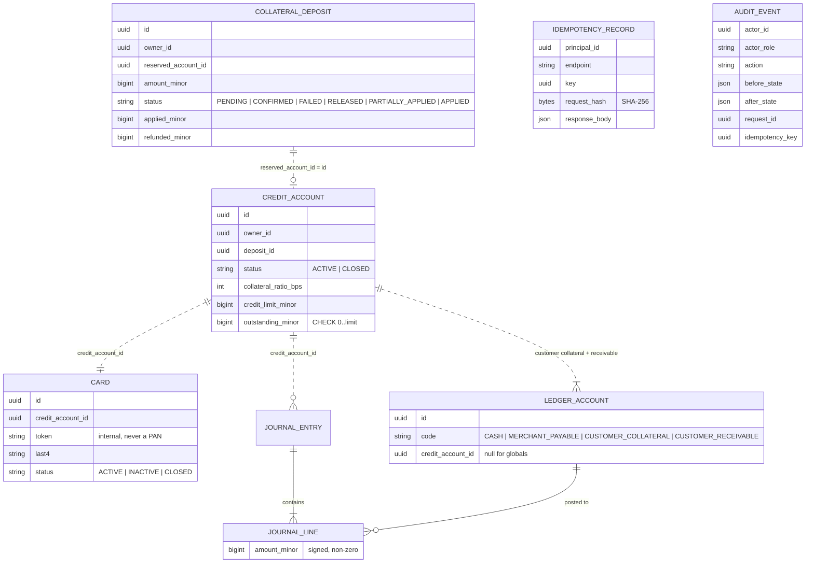
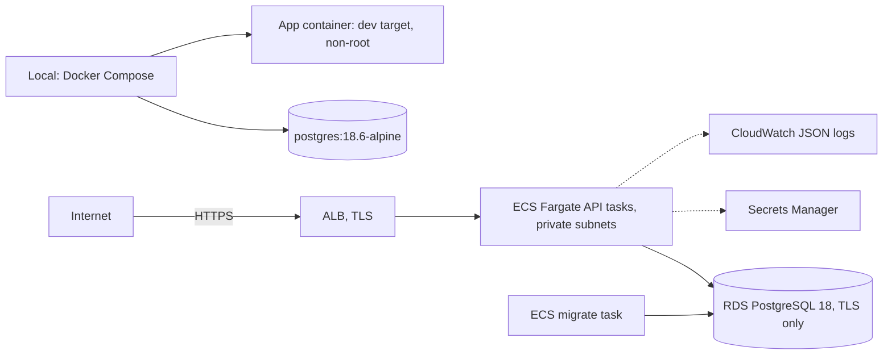

# Architecture (Memory Bank)

> Memory Bank file, refreshed in F5 against the code. Source of truth: `docs/architecture.md` and ADR 0001–0009.

## System overview



`core` imports only `<app>.services`; the six apps import nothing from each other or from `core` (import-linter DEP-1/DEP-2).

## Request flow (money operation)

```mermaid
sequenceDiagram
    participant Client
    participant MW as Request id middleware
    participant View as DRF view + idempotent wrapper
    participant Flow as core/flows
    participant DB as PostgreSQL
    Client->>MW: POST + Bearer/Signature + Idempotency-Key
    MW->>View: request_id in ContextVar
    View->>View: authenticate → principal + role, permission, key check
    View->>DB: BEGIN; SET LOCAL lock_timeout
    View->>DB: INSERT idempotency record ON CONFLICT DO NOTHING (first write)
    alt key already completed
        View-->>Client: stored response + Idempotent-Replayed
    end
    View->>Flow: run operation (savepoint)
    Flow->>DB: SELECT credit account FOR UPDATE (then deposit, then card)
    Flow->>Flow: validate state and balance under the lock
    Flow->>DB: journal entry + lines, cache update (CHECK), state changes
    Flow->>DB: audit events (same transaction)
    View->>DB: store response (< 500) in the idempotency record
    View->>DB: COMMIT (deferred triggers: balanced entries, complete record)
    View-->>Client: response + X-Request-ID
```

## Data model

Cross-app references are UUIDs without foreign keys (dashed).



## Deployment



AWS is Terraform code under `infra/terraform/`, validated (`make infra-check`, CI) and not applied.

## Module responsibilities

| Module | Owns |
| --- | --- |
| `accounts` | `CreditAccount`, its state machine and balance cache guards |
| `collateral` | `CollateralDeposit`, its state machine and settlement guards |
| `cards` | `Card` (token + last 4), its state machine |
| `ledger` | Ledger accounts, journal entries and lines, posting templates, append-only and balance triggers |
| `idempotency` | `IdempotencyRecord`, fingerprint, claim/complete |
| `audit` | `AuditEvent`, append-only, secret-free states |
| `core` | Flows, API, auth (tokens, webhook signatures), money parsing, request context, JSON logging, `reconcile` |
