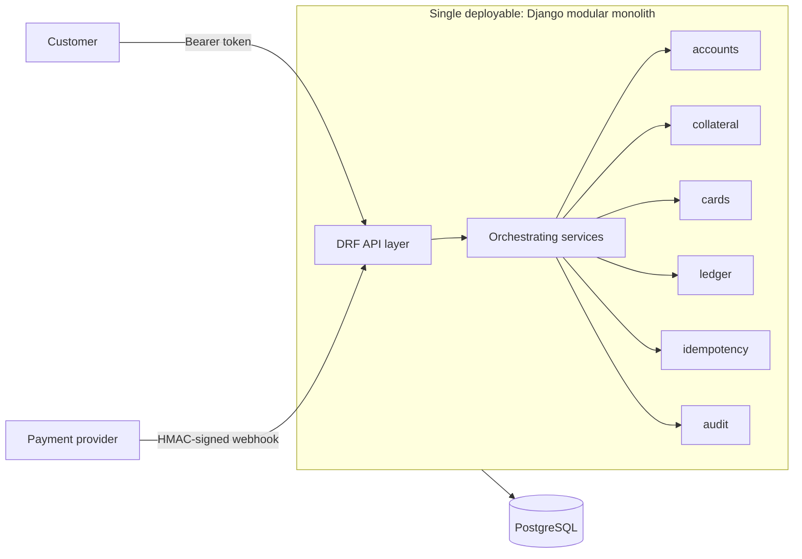
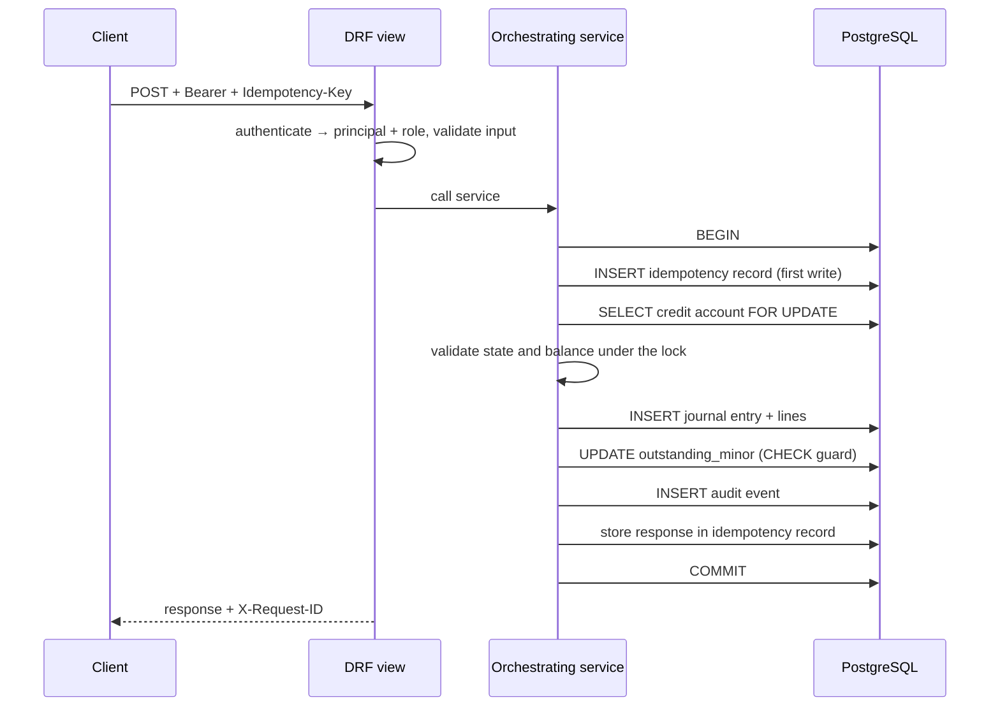
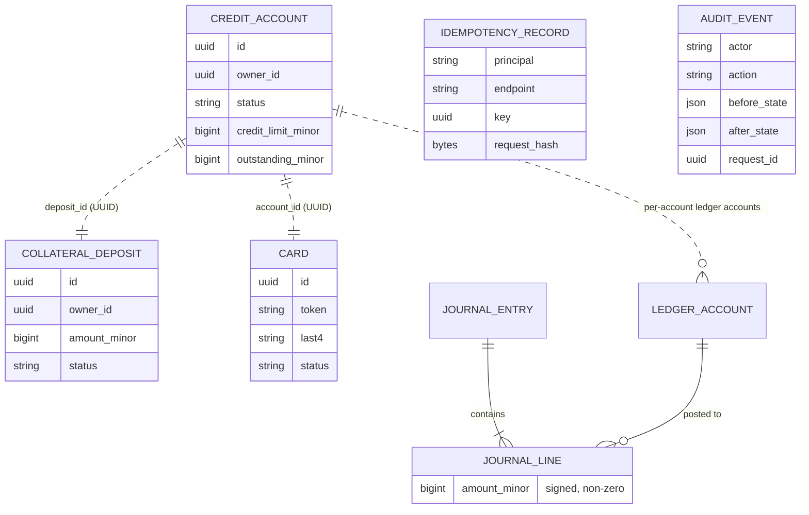
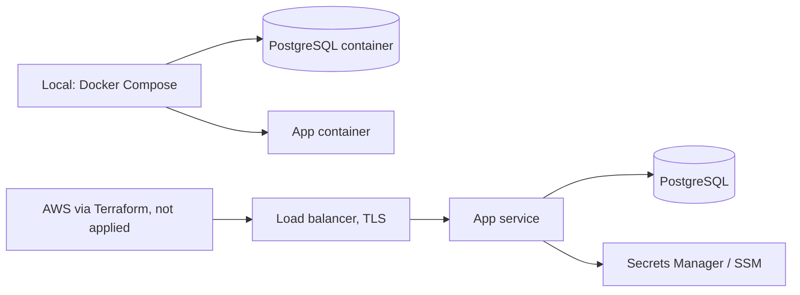

# Architecture (Memory Bank)

> Memory Bank file. Source of truth: `docs/architecture.md`. Diagrams describe the **target** design; no code exists yet.

## System overview

## Request flow (money operation)

## Data model (target)

Cross-app references are UUIDs without foreign keys (dashed).

## Deployment (target)

## App responsibilities

| App | Owns |
| --- | --- |
| `accounts` | `CreditAccount` and its balance cache |
| `collateral` | `CollateralDeposit` |
| `cards` | `Card` |
| `ledger` | `LedgerAccount`, `JournalEntry`, `JournalLine` |
| `idempotency` | `IdempotencyRecord` |
| `audit` | `AuditEvent` |

Operations core (`backend/core/`) and dependency direction: see `docs/architecture.md` §3.
