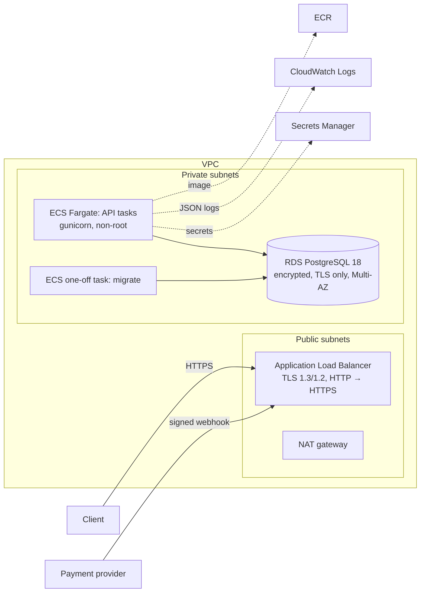
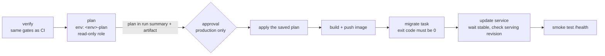

# AWS infrastructure (Terraform)

Infrastructure as code for running the service on AWS (ARCH-2), plus a manual, approved deploy pipeline. It is **delivered as code and validated, never applied** in this exercise: `make infra-check` runs `terraform fmt -check`, `terraform validate` (stack and bootstrap) and `actionlint` on the workflows in Docker, and CI runs it on every push.

## Architecture



| File | Content |
| --- | --- |
| `versions.tf` | Terraform ≥ 1.17, AWS provider 6.71 (locked in `.terraform.lock.hcl`), S3 backend configured at init. |
| `network.tf` | VPC with two public and two private subnets, NAT gateway, security groups: internet → ALB :443/:80, ALB → API :8000, API → RDS :5432. |
| `database.tf` | RDS PostgreSQL 18, private, encrypted, `rds.force_ssl=1`, Multi-AZ, deletion protection, 14-day backups, master password managed by RDS. |
| `secrets.tf` | Secret containers for `DJANGO_SECRET_KEY`, `AUTH_TOKENS`, `WEBHOOK_SIGNING_SECRET` and the app role password. Values are set out of band and never enter the state. |
| `service.tf` | ECR (immutable tags, scan on push), CloudWatch log group, ECS cluster, API task + service with deployment circuit breaker, one-off migrate task, ALB with `/health` checks. |
| `iam.tf` | Execution role limited to the app's secrets; task role with no permissions (the app calls no AWS API). |
| `sql/app_role.sql` | Least-privilege database role for the API. |

## Security decisions

- **TLS everywhere outside the VPC boundary**: the ALB terminates HTTPS (SEC: TLS out of the service's scope); RDS rejects non-TLS connections and the API connects with `POSTGRES_SSLMODE=require`.
- **Secrets only from Secrets Manager**, injected by ECS as environment variables (SEC-SECRET-1..4). The service refuses to start if any is missing.
- **Two database roles.** Migrations run as the RDS master user (`acme_admin`), which owns the schema and the guard triggers. The API runs as `acme_app` (`sql/app_role.sql`): `SELECT`, `INSERT`, `UPDATE` only — no DDL, no `DELETE`, no `TRUNCATE`, no way to disable triggers.
- **The append-only guards hold in RDS for every role.** RDS's master user is `rds_superuser`, not a PostgreSQL superuser (`rolsuper = false`), so the `TRUNCATE` exemption of LED-4 / AUD-3 / idempotency never applies there; `UPDATE`/`DELETE` on journal, audit and idempotency rows are rejected for everyone.
- **Migrations are not run by API tasks**: a separate task runs them before each deployment, so replicas never race on schema changes.

## Deploy pipeline

`.github/workflows/deploy.yml`, rationale in [ADR 0010](../../docs/decisions/0010-deploy-pipeline.md). It runs **only by hand** (Actions → Deploy → Run workflow → `staging` or `production`):



- **Plan before approval**: the reviewer approves the exact plan that will be applied.
- **Migrations first**: Terraform ignores the service's task definition, so new code serves traffic only after the migrate task succeeded. Migrations must therefore stay backward compatible with the version still running.
- **No stored AWS keys**: each job gets short-lived OIDC credentials from a role that only that GitHub Environment of this repository can assume.

| File | Content |
| --- | --- |
| `bootstrap/` | One-time stack (local state, applied by an administrator): state bucket (versioned, KMS-encrypted, TLS-only, S3 lock files), GitHub OIDC provider, per environment a read-only plan role, a deploy role and the workload permissions boundary. |
| `environments/<env>.tfvars.json` | Non-secret sizing per environment (task count, database class, Multi-AZ, log retention). |

### Deploy role permissions

`PowerUserAccess` (no IAM, no Organizations) plus IAM limited to the stack's own roles (`<project>-<env>-*`): it can create or change them **only with the workload permissions boundary attached**, which caps any such role to pulling images, writing logs and reading the stack's secrets. The GitHub roles themselves (`github-<project>-<env>-*`) are outside that pattern, so the deploy role cannot modify itself.

### One-time setup

1. **Bootstrap** (administrator, from a workstation):

   ```bash
   cd infra/terraform/bootstrap && terraform init && terraform apply
   ```

2. **GitHub Environments** (Settings → Environments), each restricted to the `main` branch:

   | Environment | Variables | Protection |
   | --- | --- | --- |
   | `staging-plan`, `production-plan` | `AWS_REGION`, `TF_STATE_BUCKET`, `AWS_PLAN_ROLE_ARN`, `CERTIFICATE_ARN`, `ALLOWED_HOSTS`, `WORKLOAD_PERMISSIONS_BOUNDARY_ARN` | `main` only |
   | `staging` | `AWS_REGION`, `TF_STATE_BUCKET`, `AWS_DEPLOY_ROLE_ARN`, `API_BASE_URL` | `main` only |
   | `production` | same as `staging` | `main` only + **required reviewers** |

   Role ARNs, the bucket and the boundary come from the bootstrap outputs.

3. **First deployment of an environment.** The first run creates the infrastructure and then **stops at the migration step on purpose**, because the new secrets have no values yet. Then:
   - fill the secrets: `aws secretsmanager put-secret-value --secret-id <app_secret_arns.*> --secret-string '...'` for `django_secret_key`, `auth_tokens`, `webhook_signing_secret` and `db_app_password`;
   - create the API's database role from inside the VPC (for example a one-off ECS task with the `postgres` image, or an SSM session), with `sql/app_role.sql`; its default privileges also cover the tables the first migration will create;
   - run the workflow again: migrations, rollout and smoke test complete.

## Not covered

WAF, custom domain and DNS records, autoscaling policies, alarms and dashboards, automated creation of the API database role, and key rotation schedules.
