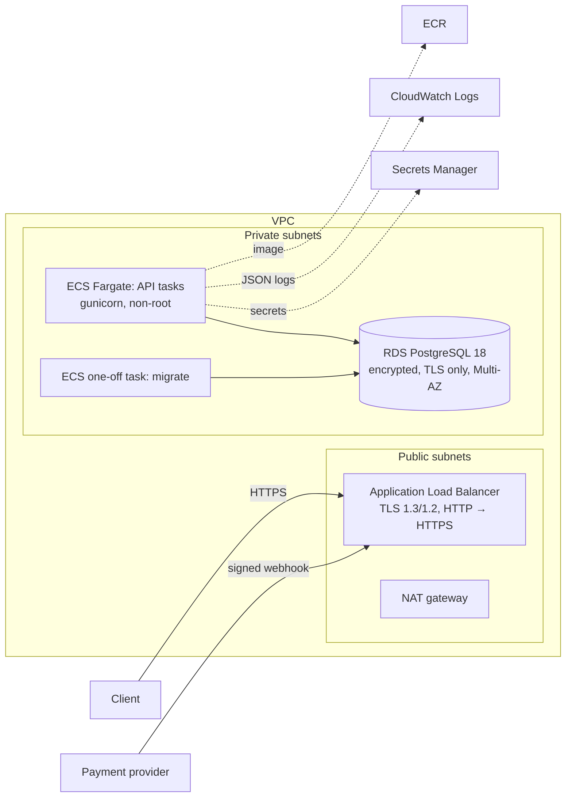

# AWS infrastructure (Terraform)

Infrastructure as code for running the service on AWS (ARCH-2). It is **delivered as code and validated, never applied** in this exercise: `make infra-check` runs `terraform fmt -check` and `terraform validate` in Docker, and CI runs it on every push.

## Architecture



| File | Content |
| --- | --- |
| `versions.tf` | Terraform ≥ 1.17, AWS provider 6.71 (locked in `.terraform.lock.hcl`), S3 backend configured at init. |
| `network.tf` | VPC with two public and two private subnets, NAT gateway, security groups: internet → ALB :443/:80, ALB → API :8000, API → RDS :5432. |
| `database.tf` | RDS PostgreSQL 18, private, encrypted, `rds.force_ssl=1`, Multi-AZ, deletion protection, 14-day backups, master password managed by RDS. |
| `secrets.tf` | Secret containers for `DJANGO_SECRET_KEY`, `AUTH_TOKENS`, `WEBHOOK_SIGNING_SECRET` and the app role password. Values are set out of band and never enter the state. |
| `service.tf` | ECR (immutable tags, scan on push), CloudWatch log group, ECS cluster, API task + service with deployment circuit breaker, one-off migrate task, ALB with `/health` checks. |
| `iam.tf` | Execution role limited to the app's secrets; task role with no permissions (the app calls no AWS API). |
| `sql/app_role.sql` | Least-privilege database role for the API. |

## Security decisions

- **TLS everywhere outside the VPC boundary**: the ALB terminates HTTPS (SEC: TLS out of the service's scope); RDS rejects non-TLS connections and the API connects with `POSTGRES_SSLMODE=require`.
- **Secrets only from Secrets Manager**, injected by ECS as environment variables (SEC-SECRET-1..4). The service refuses to start if any is missing.
- **Two database roles.** Migrations run as the RDS master user (`acme_admin`), which owns the schema and the guard triggers. The API runs as `acme_app` (`sql/app_role.sql`): `SELECT`, `INSERT`, `UPDATE` only — no DDL, no `DELETE`, no `TRUNCATE`, no way to disable triggers.
- **The append-only guards hold in RDS for every role.** RDS's master user is `rds_superuser`, not a PostgreSQL superuser (`rolsuper = false`), so the `TRUNCATE` exemption of LED-4 / AUD-3 / idempotency never applies there; `UPDATE`/`DELETE` on journal, audit and idempotency rows are rejected for everyone.
- **Migrations are not run by API tasks**: a separate task runs them before each deployment, so replicas never race on schema changes.

## Deploying (outline)

```bash
# 1. Infrastructure
terraform init -backend-config="bucket=<state-bucket>" -backend-config="key=acme/terraform.tfstate"
terraform apply -var certificate_arn=<acm-arn> -var allowed_hosts=api.example.com -var image_tag=<tag>

# 2. Secrets (once)
aws secretsmanager put-secret-value --secret-id <app_secret_arns.django_secret_key> --secret-string '...'
# ...auth_tokens, webhook_signing_secret, db_app_password

# 3. Image (production target, without test tools)
docker build --target runtime -t <ecr_repository_url>:<tag> backend && docker push <ecr_repository_url>:<tag>

# 4. Schema, then the least-privilege role (first deployment only)
aws ecs run-task --cluster <cluster_name> --task-definition <migrate_task_definition> --launch-type FARGATE ...
psql "host=<database_address> dbname=acme user=acme_admin sslmode=require" -v app_password="'...'" -f sql/app_role.sql
```

## Not covered

WAF, custom domain and DNS records, autoscaling policies, alarms and dashboards, a CI/CD deploy pipeline, and key rotation schedules.
